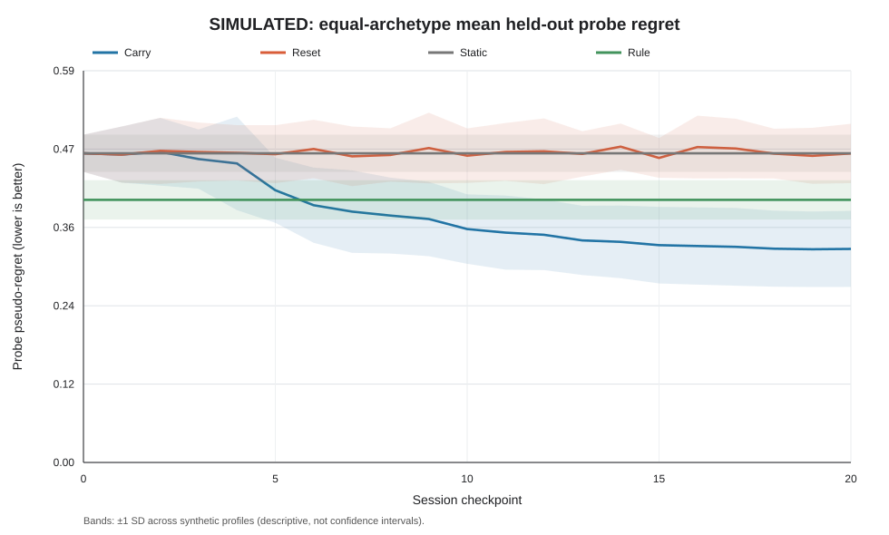
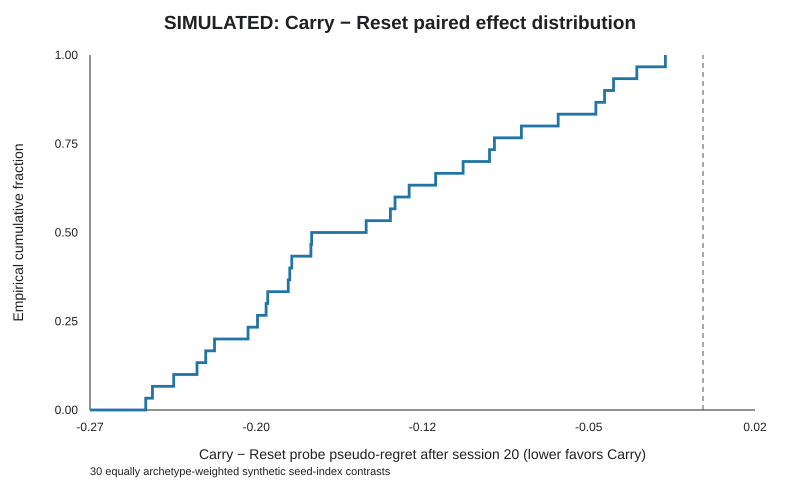
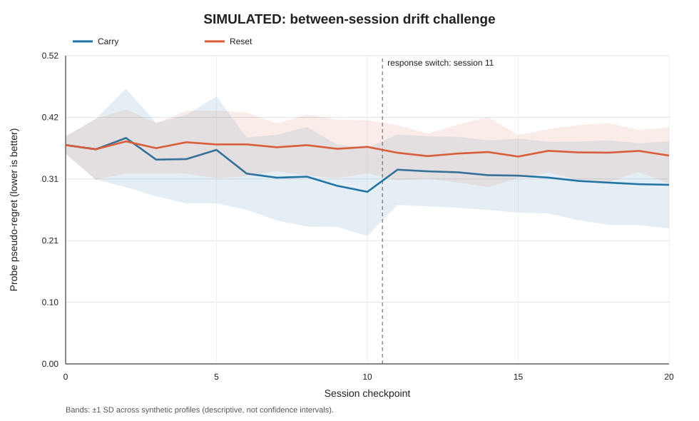
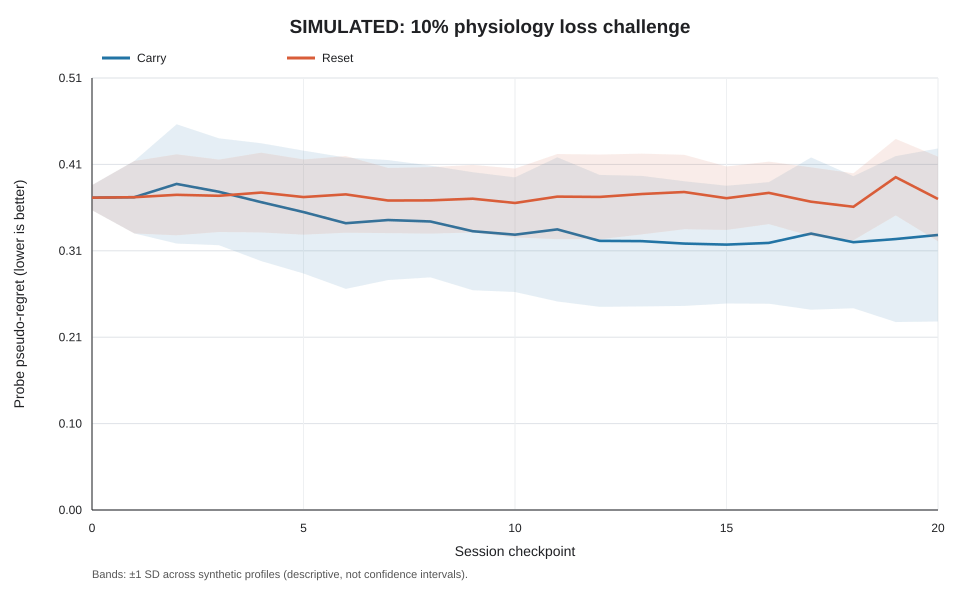
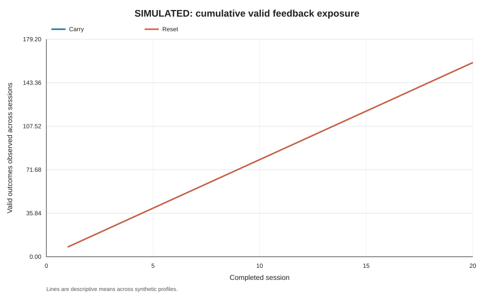

# Longitudinal Study A — simulated results, frozen v1.0

- **Run:** `20261019T162847Z-longitudinal-full`
- **Protocol:** `laminar-vr-longitudinal-simulation-v1.0`; investigator freeze date 2026-10-19
- **Source commit:** `4886f73b34c3589cf35b7b6f7f83dceacc6eca71`; dirty at run: `false`
- **Unity:** `6000.0.82f1`; visual bundle `temple-pond-pilot-freeze-v3`; mapping `temple-pond-mapping-pilot-v4`
- **Validation:** `passed`; complete frozen matrix `true`

## Primary decision-quality result

The prespecified contrast is Carry minus Reset mean safe-oracle probe pseudo-regret after session 20, equally weighted across A1–A7. Negative values favor Carry. Synthetic profiles, not people, are the replication units.

- Paired mean: **-0.1445**; median -0.1606; seed-index SD 0.0694.
- 95% paired bootstrap interval: **[-0.1687, -0.1205]**; two-sided 100,000-draw sign-flip p = **9.9999e-06**.
- Directional criterion met: **true**. Carry was better for 100.0% of the 30 equally weighted seed-index contrasts and 83.3% of the 210 paired archetype profiles.
- Mean baseline probe regret: Carry 0.4680, Reset 0.4680; after session 20: Carry 0.3232, Reset 0.4678.

The Monte Carlo p-value is at the 100,000-draw add-one resolution; it is not an exact zero-probability result. The bootstrap interval describes variation across synthetic seed indexes under this simulator.

| Archetype | Carry baseline | Reset baseline | Carry after 20 | Reset after 20 | Carry − Reset | Profiles favoring Carry |
|---|---:|---:|---:|---:|---:|---:|
| A1PreferenceAlignedBalanced | 0.3763 | 0.3763 | 0.3017 | 0.3779 | -0.0762 | 23/30 |
| A2IlluminationDominant | 0.4366 | 0.4366 | 0.3668 | 0.4149 | -0.0481 | 22/30 |
| A3WarmthDominant | 0.6479 | 0.6479 | 0.6026 | 0.6586 | -0.0560 | 24/30 |
| A4SoftnessRichnessInteraction | 0.6471 | 0.6471 | 0.5091 | 0.6555 | -0.1464 | 27/30 |
| A5MotionAverseThreshold | 0.7240 | 0.7240 | 0.1994 | 0.7282 | -0.5288 | 30/30 |
| A6PreferencePhysiologyConflict | 0.3735 | 0.3735 | 0.2215 | 0.3691 | -0.1476 | 29/30 |
| A7WeakResponder | 0.0706 | 0.0706 | 0.0616 | 0.0703 | -0.0087 | 20/30 |

*Figure 1. Simulated held-out probe pseudo-regret by session checkpoint. The pooled curve weights A1–A7 equally. Bands are ±1 SD across synthetic seed-index aggregates, not confidence intervals.*

*Figure 2. Distribution of the 30 equally archetype-weighted paired seed-index contrasts after session 20.*

## Longitudinal and challenge results (descriptive)

The seven individual A1–A7 learning curves and their between-profile SD bands are in `figures/primary-01-probe-learning.svg` through `primary-07-probe-learning.svg`. A5 has the largest mean advantage; A7 has the smallest. This heterogeneity is retained in the table rather than hidden by the pooled estimate.

| Challenge | Checkpoint | Carry probe regret | Reset probe regret | Carry − Reset |
|---|---:|---:|---:|---:|
| BetweenSessionDrift | 0 | 0.3709 | 0.3709 | 0.0000 |
| BetweenSessionDrift | 10 | 0.2916 | 0.3678 | -0.0762 |
| BetweenSessionDrift | 11 | 0.3292 | 0.3579 | -0.0287 |
| BetweenSessionDrift | 12 | 0.3264 | 0.3522 | -0.0258 |
| BetweenSessionDrift | 20 | 0.3036 | 0.3531 | -0.0496 |
| MildPhysiologyLoss | 0 | 0.3709 | 0.3709 | 0.0000 |
| MildPhysiologyLoss | 10 | 0.3270 | 0.3646 | -0.0377 |
| MildPhysiologyLoss | 11 | 0.3333 | 0.3722 | -0.0389 |
| MildPhysiologyLoss | 12 | 0.3196 | 0.3718 | -0.0522 |
| MildPhysiologyLoss | 20 | 0.3266 | 0.3694 | -0.0428 |
| NonResponder | 0 | 0.0000 | 0.0000 | 0.0000 |
| NonResponder | 10 | 0.0000 | 0.0000 | 0.0000 |
| NonResponder | 11 | 0.0000 | 0.0000 | 0.0000 |
| NonResponder | 12 | 0.0000 | 0.0000 | 0.0000 |
| NonResponder | 20 | 0.0000 | 0.0000 | 0.0000 |

For the drift challenge, the response optimum switches at session 11. A9 is a negative control with zero modeled environment effect, so its safe-oracle probe regret is zero for both policies by construction. Neither challenge is an additional confirmatory test.

*Figure 3. Simulated drift challenge with the session-11 response switch marked; bands show ±1 SD across synthetic profiles.*

*Figure 4. Simulated 10% physiology-emission loss challenge; bands show ±1 SD across synthetic profiles.*

The full primary policy comparison by early (sessions 1–5), middle (6–15), and late (16–20) periods follows. Trajectory regret uses eligible decisions as denominator, and availability is shown separately. These are descriptive totals across synthetic profiles, not independent-session tests.

| Period | Policy | Eligible decisions | Valid outcomes | Trajectory regret / eligible decision | Stress-change available sessions | Mean synthetic stress change / available session |
|---|---|---:|---:|---:|---:|---:|
| early | Carry | 8400 | 8400 | 0.2678 | 1050 | -0.5139 |
| early | Reset | 8400 | 8400 | 0.2847 | 1050 | -0.5013 |
| early | Static | 8400 | 8400 | 0.3003 | 1050 | -0.6799 |
| early | Rule | 9019 | 6406 | 0.1575 | 1050 | -0.7146 |
| middle | Carry | 16800 | 16800 | 0.1135 | 2100 | -0.8136 |
| middle | Reset | 16800 | 16800 | 0.2791 | 2100 | -0.4722 |
| middle | Static | 16800 | 16800 | 0.3003 | 2100 | -0.6813 |
| middle | Rule | 18148 | 12528 | 0.1532 | 2100 | -0.7161 |
| late | Carry | 8400 | 8400 | 0.0568 | 1050 | -0.9417 |
| late | Reset | 8400 | 8400 | 0.2802 | 1050 | -0.4679 |
| late | Static | 8400 | 8400 | 0.3003 | 1050 | -0.6812 |
| late | Rule | 9028 | 6350 | 0.1593 | 1050 | -0.7218 |

*Figure 5. Mean cumulative valid feedback across primary synthetic profiles. Reset observes feedback but starts each session with a fresh LinUCB model.*

## Safety, attribution, and availability

Across 20,400 simulated sessions, the recorded scene-limit violations, multi-dimension violations, and invalid model updates were 0, 0, and 0. The safety layer rejected 10,911 proposals, while 33,941 visual transitions started. Rejections are expected safety actions, not executed violations.

Recorded reward events: 152,774 applied, 340 invalidated. There were 188 zero-eligible sessions, 188 baseline-unavailable sessions, and 2,230 dropped synthetic physiology emissions. Complete counts by scenario and condition are in `safety-summary.csv`.

Accepted-window synthetic stress, heart-rate, and RMSSD changes and observed-window stress AUC are in `physiology-summary.csv`. The AUC uses trapezoids between accepted samples only and is not a complete continuous-physiology integral when emissions are missing.

## Interpretation and reporting limits

This result supports learning of the declared synthetic response laws by evaluation-only cross-session LinUCB carry-over. It does not establish stress reduction, safety, usability, or comfort in people. The deployed pilot still resets LinUCB each session. Its feature schema has no explicit session-context features. Study B human outcomes must be reported separately.

The raw CSVs do not separately report final environment distance to the simulator optimum, snapshot-restore failure counts, reused physiology-window counts, or pause/network boundary violations. A completed trajectory and analyzer continuity check do not replace those direct measures. Do not report them as zero. This is a reporting gap against the frozen secondary-outcome checklist.

The optional three-checkpoint practical-margin endpoint was omitted before the full run. No additional inferential test was added after inspecting the full-study output. Supervisor/team sign-off remains unrecorded in the repository.

## Reproducibility files

`primary-archetype.csv`, `probe-curve.csv`, `session-curve.csv`, `period-summary.csv`, `safety-summary.csv`, and `physiology-summary.csv` contain the descriptive values. `report-manifest.json` records the raw source and generated-file checksums. All charts are explicitly labelled simulated SVGs. The raw run folder is `C:/My partition/SLIIT/Year 4/Semester 1/Research Project/R26-DS-006/analysis/component-c-bandit-evaluation/longitudinal/runs/20261019T162847Z-longitudinal-full`.
